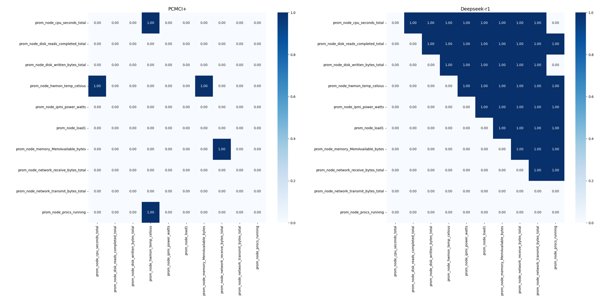

# LLM-Driven Causal Discovery for Monitoring Metrics

<p align="center">
  
  &nbsp;&nbsp;
  
  &nbsp;&nbsp;
  
  &nbsp;&nbsp;
  
</p>

Code for the paper **"LLM-Driven Causal Discovery for Monitoring Metrics in Computing Continuum Systems: A
Comparative Study"** (Ahmad Atwi, Abdelkader Lahmadi, IEEE LCN 2025).

Monitoring a Cloud–Edge–IoT system produces hundreds of metrics, and collecting all of them is expensive. Knowing
which metrics influence which others helps decide what to monitor. Since monitoring metrics are not always available, we used the textual descriptions of the metrics for this causality inference . This works do a comparative study between different open source LLM alongside GPT model and asks Large Language Models to
find the causal relations between metrics **from the names and descriptions of the metrics only**, without any time series, and
compares the result across the models and against data-driven causal discovery (PCMCI+, VarLiNGAM). Additionally we proposed a batch-prompting strategy to address the scalability limitation of the pairwise prompting and the context window limitation in general.

Two prompting strategies are implemented:

- **Pairwise prompting**: one query per pair of metrics, asking whether A causes B, B causes A, or neither.
  This needs n(n-1)/2 queries.
- **Batch prompting** (proposed in the paper): each metric is taken as a *root*, and the model is asked which
  metrics in a batch of size *b* are caused by it. This needs about n²/2b queries and gives the model more
  context per query.

Both can be restricted to **direct** relations or include **indirect** (transitive) ones.



*Adjacency matrices on 10 node-level metrics: PCMCI+ on the time series (left) and DeepSeek-R1 with batch
prompting on the descriptions only (right).*

## Main results

On metrics collected from a video-processing application deployed on Grid'5000 (K3s, Prometheus, Kwollect):

- Batch prompting gives much higher agreement between models than pairwise prompting. For example, the Jaccard
  similarity between Gemma3-27B and DeepSeek-R1-70B goes from 0.16 to 0.48 on direct relations.
- With direct and indirect relations, DeepSeek-R1-70B and LLaMA3.3-70B share 93% of their edges (batch size 4)
  and produce identical graphs with batch size 7.
- On 100 metrics, DeepSeek-R1 and LLaMA3.3 still agree on about 80% of the edges.
- The LLM graphs overlap with data-driven ones: 4 of the 5 VarLiNGAM edges and 17 of the 30 PCMCI+ edges are
  also found by DeepSeek-R1.

## Setup

Python 3.10 was used for the experiments.

```bash
python -m venv .venv && source .venv/bin/activate
pip install -r requirements.txt
```

### LLM backends

- **Open-source models** run locally with [Ollama](https://ollama.com). Start the server and pull the models:
  ```bash
  ollama pull llama3.3:70b
  ollama pull deepseek-r1:70b
  ollama pull gemma3:27b
  ollama pull mixtral:8x7b
  ollama pull mistral
  ```
  The 70B models need a large GPU (the paper used an NVIDIA RTX A6000).
- **GPT-4 Turbo** goes through the OpenAI API. Put your key in an environment variable, never in the code:
  ```bash
  export OPENAI_API_KEY=...
  ```

### Data

The LLM methods only use the metric descriptions, which are in
[`data/var_names_and_desc.py`](data/var_names_and_desc.py) for the three metric sets used in the paper
(`cloud_edge_kwollect_10`, `_30` and `_100`).

The data-driven methods (PCMCI+, VarLiNGAM, PC, ...) also need the time series. They are read from
`data/<dataset>.csv`: one column per metric (with the same names as in the description file) and one row per
timestamp.
The time series of the 10- and 30-metric sets are included (`data/cloud_edge_kwollect_10.csv` and
`data/cloud_edge_kwollect_30.csv`, 361 timestamps each), so the baselines can be run directly.

The bnlearn benchmark networks `asia`, `child`, `alarm` and `insurance` are included as well. For them, data is
sampled from the network and the result is scored against the true graph.

## Running

Each run discovers one graph and saves it in `logs/<dataset>/` as a `.npy` adjacency matrix (`[i, j] = 1`
means *i causes j*), with a `.json` file holding the settings and variable names.

```bash
# Batch prompting, direct + indirect relations, batch size 7, DeepSeek-R1 through Ollama
python run.py --dataset cloud_edge_kwollect_10 --alg llm_batch --model deepseek-r1:70b \
              --relations all --batch_size 7

# Pairwise prompting, direct relations only, GPT-4 Turbo
python run.py --dataset cloud_edge_kwollect_10 --alg llm_pairwise --backend openai \
              --model gpt-4-1106-preview --relations direct

# Data-driven baselines (need data/cloud_edge_kwollect_10.csv)
python run.py --dataset cloud_edge_kwollect_10 --alg pcmci_plus --tau_max 1 --pc_alpha 0.01 --threshold 0.05
python run.py --dataset cloud_edge_kwollect_10 --alg varlingam --lag 1 --threshold 0.05
```

Main options:

| Option | Values | Meaning |
|---|---|---|
| `--alg` | `llm_batch`, `llm_pairwise`, `pcmci_plus`, `varlingam`, `pc`, `ges`, `fci`, `notears`, `dagma_linear`, `dagma_nonlinear` | method |
| `--backend` | `ollama`, `openai` | where the LLM runs |
| `--model` | e.g. `llama3.3:70b`, `gpt-4-1106-preview` | LLM to use |
| `--relations` | `direct`, `all` | direct relations only, or direct and indirect |
| `--batch_size` | 1, 4, 7, 10, ... | variables per query for `llm_batch` |
| `--num_ctx` | e.g. 2048 | Ollama context length |
| `--with_statistics` | flag | add Pearson correlations to the prompts (needs the CSV) |
| `--plot` | flag | also save a picture of the graph |

The prompts and the model's reasoning are printed to the terminal, so it is worth keeping them:
`python run.py ... | tee run.log`.

### Comparing graphs

There is no ground truth causal graphs for the monitoring metrics, so graphs are compared with each other using the metrics
from the paper: Jaccard similarity, edge difference ratio (EDR) and structural Hamming distance (SHD).

```bash
python scripts/compare_graphs.py logs/cloud_edge_kwollect_10/llm_batch_*_all_bs4.npy
```
```
graph A                            graph B                         edges A  edges B  overlap  jaccard    EDR  SHD
llm_batch_deepseek-r1-70b_all_bs4  llm_batch_llama3.3-70b_all_bs4       41       44       41    0.932  0.068    3
...
```

`--heatmap out.png` draws the first two matrices side by side, and `scripts/plot_graph.py` opens a graph in an
interactive view where clicking an edge highlights it.

## Reproducing the paper

`scripts/run_paper_experiments.sh` runs pairwise and batch prompting (direct, and direct + indirect, batch sizes
4, 7 and 10) for all six models on the 10-metric set, then prints the comparison tables:

```bash
bash scripts/run_paper_experiments.sh
DATASET=cloud_edge_kwollect_30 bash scripts/run_paper_experiments.sh   # scalability study
```

| Paper | Command |
|---|---|
| Table II (pairwise vs batch, direct) | `--alg llm_pairwise --relations direct` and `--alg llm_batch --relations direct --batch_size 4` |
| Table III (direct and indirect) | same with `--relations all` |
| Table VII (batch size) | `--alg llm_batch --relations all --batch_size {4,7,10}` |
| Scalability (30 and 100 metrics) | `--dataset cloud_edge_kwollect_30` / `_100`, `--batch_size 7` |
| Table IV (PCMCI+) | `--alg pcmci_plus --tau_max {1,3} --pc_alpha {0.01,0.05} --threshold {0.05,0.04,0.01}` |
| Table IV (VarLiNGAM) | `--alg varlingam --lag 1 --threshold 0.05` and `--lag 3 --threshold 0.06` |

**About reproducibility.** All queries use temperature 0 and a fixed seed, and the order of the pairs in pairwise
prompting is fixed with `--seed`. LLM outputs can still change slightly between runs, GPUs, Ollama versions or
model updates (floating-point and parallelism effects, and hosted models such as GPT-4 change over time). Expect
the same overall trends and similar agreement scores, not identical edge lists. The data-driven baselines are
deterministic: VarLiNGAM gives the same 5 and 11 edges as in Table IV.

## Repository structure

```
run.py                     entry point: one method, one dataset
args.py                    command-line options
algs/llm/batch.py          batch prompting
algs/llm/pairwise.py       pairwise prompting
algs/llm/clients.py        Ollama / OpenAI access
algs/pcmci, algs/VarLiNGAM time-series baselines used in the paper
algs/pc, ges, fci, notears, dagma_baseline   other data-driven baselines
data/var_names_and_desc.py metric names and descriptions
data/init_prompts.py       system / user role prompts per dataset
scripts/                   graph comparison, plotting, experiment script
metrics.py                 precision, recall, F1, NHD against a known graph (bnlearn benchmarks)
```

## Notes

- Certain details were adapted from the work of  [Jiralerspong et al., "Efficient Causal Graph Discovery Using Large Language
  Models"]

## Citation

```bibtex
@inproceedings{atwi2025llm,
  title={LLM-Driven Causal Discovery for Monitoring Metrics in Computing Continuum Systems: A Comparative Study},
  author={Atwi, Ahmad and Lahmadi, Abdelkader},
  booktitle={2025 IEEE 50th Conference on Local Computer Networks (LCN)},
  pages={1--8},
  year={2025},
  organization={IEEE}
}
```

This work was partially funded by the French ANR under the France 2030 program, project SPIREC of PEPR Cloud
(ANR-23-PECL-0006).
